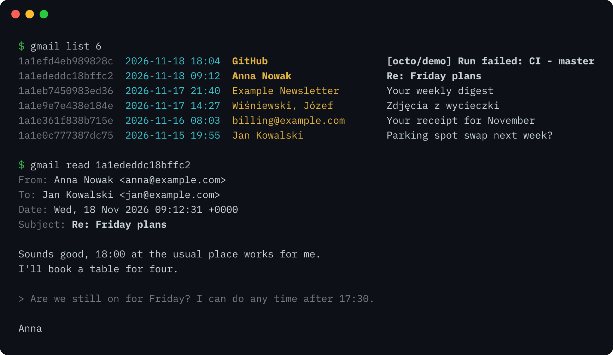
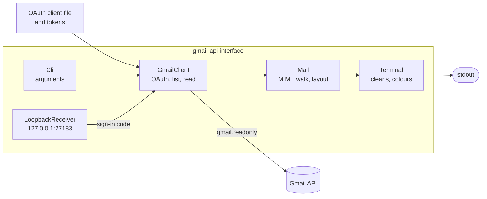

<h1 align="center">gmail-api-interface</h1>

<div align="center">

[Latest release](https://github.com/straightchlorine/gmail-api-interface/releases/latest) &middot; [Quick Start](#quick-start) &middot; [Setup](#setup)

[](https://github.com/straightchlorine/gmail-api-interface/releases)
[](https://github.com/straightchlorine/gmail-api-interface/actions/workflows/ci.yml)
[](#quick-start)

Read-only Gmail CLI in Java: list the inbox, search all mail, read a message as plain text.

</div>

<p align="center">
  
</p>

<p align="center"><sub>Made-up messages served by a mock Gmail API. The layout and colours are the tool's own output.</sub></p>

## Architecture



`Cli` checks the arguments and owns the exit code. `GmailClient` signs in with OAuth 2.0 and asks only for
the `gmail.readonly` scope, so the tool cannot send, delete or change anything.

During sign-in, `LoopbackReceiver` waits for Google's redirect at `http://127.0.0.1:27183/Callback`.
The address is always the same, only this machine can reach it, and a redirect counts only if it
carries the random `state` value of that run.

Listing makes one `messages.list` call, then one small `format=metadata` call per message that asks only
for `From` and `Subject`. Reading makes one `format=full` call, and `Mail` takes the body from every
`text/plain` part that isn't an attachment, found by walking the `multipart/*` tree.

Header and body text comes from strangers, so `Terminal` removes terminal control and bidi characters
from it before it is printed.

It's a rather old project, back from 2022. It was a prototype for a study of using the Google APIs.
This is a rewrite of that project.

## What it does

- Lists the newest inbox messages, one per line: ID, date, sender and subject
- Searches all mail with [Gmail search syntax](https://support.google.com/mail/answer/7190)
- Prints one message as plain text: the From, To, Date and Subject headers, then the body
- Stays read-only, with the `gmail.readonly` scope and nothing else

## Quick Start

You need JDK 17 or newer and, a Google OAuth client file: see [Setup](#setup).

Download `gmail-api-interface-1.0.0.zip` (or `.tar`) from the
[latest release](https://github.com/straightchlorine/gmail-api-interface/releases/latest)
and unpack it. Then, in the folder you unpacked it into:

```bash
alias gmail="'$PWD/gmail-api-interface-1.0.0/bin/gmail-api-interface'"

gmail                                  # newest 20 inbox messages
gmail list 50
gmail list 10 from:github is:unread    # searches all mail; add in:inbox to restrict
gmail read 1a1ededdc18bffc2            # ID from the first column of list
```

To build from source instead, run `./gradlew installDist`. Files are at `build/install/gmail-api-interface`.

## Usage

- `list [N] [QUERY...]` shows the newest N messages (1 to 100, default 20).
Without a query it lists the inbox. With one it searches all mail. To search for a number, give N first: `list 20 2024`.
- `read ID` prints one message.
- `--help` prints the usage text.
- Colour is used only when the output is a terminal, so `gmail list | grep ...` gets plain text.
Set `NO_COLOR=1` to turn it off.
- Exit codes: 0 ok, 1 runtime error (credentials, auth, network, API), 2 usage error.

## Setup

1. Create a project in the [Google Cloud console](https://console.cloud.google.com/).
2. Enable the **Gmail API** for it.
3. In **Google Auth Platform**, fill in Branding (app name and support email).
Set Audience to **External** with status **Testing**, and add yourself as a test user.
4. Under **Clients**, create an OAuth client of type **Desktop app** and download its JSON.
5. Move the file into place:
   ```bash
   mkdir -p ~/.config/gmail-api-interface
   mv ~/Downloads/client_secret_*.json ~/.config/gmail-api-interface/credentials.json
   ```
6. Run the tool. Open the URL it prints and approve read access. You will need to click through
"Google hasn't verified this app". Tokens are stored in `~/.config/gmail-api-interface/tokens`.

### When the sign-in ends

In Testing mode, Google ends the authorization 7 days after you approve it. You will then see "authorization expired or revoked": delete `~/.config/gmail-api-interface/tokens` and run the tool again.

The workaround is to publish the app (**Audience** > **Publish app**, status **In production**).
Google [lists personal-use apps](https://support.google.com/cloud/answer/13464323) with fewer than
100 users as not needing verification, only the "unverified app" warning stays.

## Limitations

- Read-only, and at most 100 messages per list.
- HTML is not rendered. HTML-only mail shows Gmail's short snippet instead.
For mail with an HTML body and a plain-text footer, only the footer appears.
- Text bodies of several MB show a placeholder.
- Messages attached to or forwarded as attachments of another message are not shown.
- Sign-in needs port 27183 on 127.0.0.1 to be free. If it isn't, the tool says so and exits.
- Non-ASCII text needs a UTF-8 locale. Under `LC_ALL=C` it prints as `?`.
- Tested on Linux only. On Windows the config folder is `%USERPROFILE%\.config\gmail-api-interface`, and older consoles may show the colour codes as text (set `NO_COLOR=1`).
- Many large lists in quick succession can hit Gmail's per-user rate limit (`error: 403 ...` or `error: 429 ...`).

## License

MIT License. See [LICENSE](LICENSE) for details.

---

<div align="center">

To the only God, be honour and glory for ever and ever.

</div>
